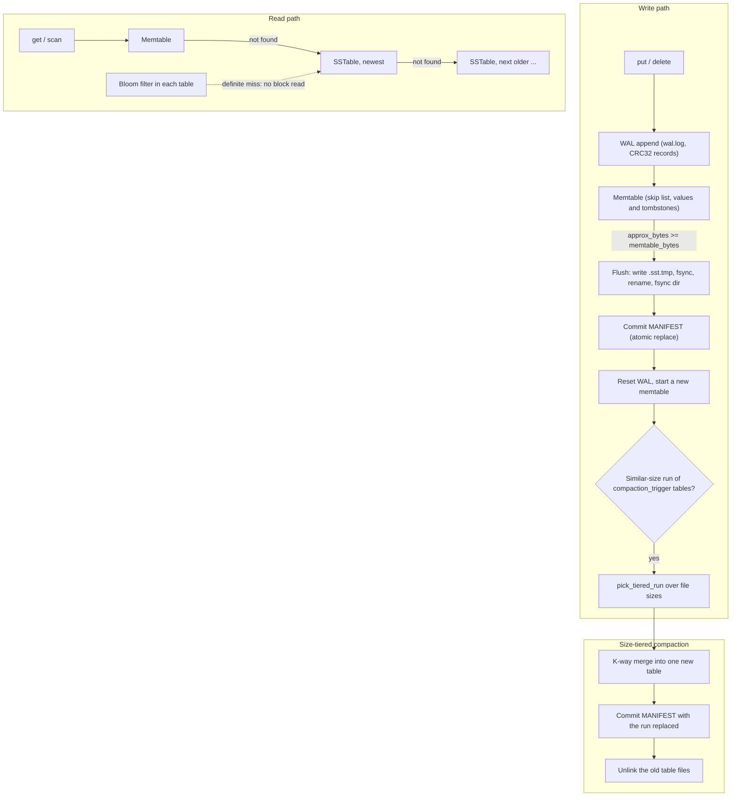

# lsm-kv

[](https://github.com/xJDvm/lsm-kv/actions/workflows/ci.yml)


An embedded, persistent, ordered key-value store built on a log-structured merge tree, in pure Python with no runtime dependencies.

## Why this is hard

`lsm-kv` is a small implementation of the design behind LevelDB, RocksDB and Cassandra. The interesting problems are:

- **Durability at any crash point.** A write must survive a crash at any byte of the log or of a table being written. This takes a checksummed write-ahead log with torn-tail recovery, atomic metadata updates (write a temporary file, fsync, rename, fsync the directory), and a recovery path that is idempotent.
- **Merging sorted sources with tombstone shadowing.** A read merges the memtable and every SSTable. The newest version of a key wins, and a delete must hide every older version. A tombstone may only be discarded when no older data can exist below it.
- **Untrusted on-disk formats.** A damaged or hostile table must raise a typed `CorruptionError`, never an `IndexError`, an oversized allocation or a silently wrong answer. Every length read from disk is checked against the file size and the configured limits before use.
- **Correctness by model-based testing.** The test suite drives the engine and a plain `dict` with the same random operations, including flushes, compactions and reopens, and requires identical answers.

## Architecture



Writes are logged before they are applied, so the memtable can always be rebuilt from the log. A flush turns the memtable into an immutable, sorted table file and publishes it through the manifest. Reads stop at the first version found, so a newer table or the memtable shadows older ones. Compaction merges adjacent tables of similar size to bound how many files a read may have to consult.

### Modules

| Module | Responsibility |
| --- | --- |
| `db.py` | Public `DB` API. Coordinates the WAL, memtable, tables, flush, compaction and recovery. |
| `wal.py` | Append-only write-ahead log with CRC32-framed records. Replay stops at the first bad record; a torn tail is truncated on open. |
| `memtable.py` | In-memory sorted buffer (skip list) holding values and tombstones. |
| `sstable.py` | Immutable, block-based table writer, and a reader that validates every block, the index and the Bloom filter. |
| `bloom.py` | Bloom filter with double hashing over BLAKE2b. Persisted inside each table. |
| `merge.py` | Lazy k-way merge with newest-wins shadowing, and tombstone removal. |
| `compaction.py` | Pure planner that chooses which adjacent, similarly sized tables to merge. |
| `manifest.py` | The atomically replaced list of live tables, table file naming, and directory fsync. |
| `types.py` | The `MISSING` sentinel, the `Entry` type, size limits and input validation. |
| `errors.py` | `LSMError`, `CorruptionError` and `ClosedError`. |
| `cli.py`, `__main__.py` | The `lsmkv inspect` and `lsmkv verify` commands for table files. |

## Quick start

Requirements: Python 3.11 or newer, and [uv](https://docs.astral.sh/uv/) (uv can install Python for you).

```bash
git clone https://github.com/xJDvm/lsm-kv.git
cd lsm-kv
uv sync
uv run pytest
```

### Usage

Keys are non-empty `bytes` of at most 64 KiB. Values are `bytes` of at most 16 MiB; an empty value is a real value, distinct from a deleted key.

```python
from lsmkv import DB

with DB.open("data") as db:
    db.put(b"user:1", b"Ada")
    db.put(b"user:2", b"Grace")
    db.put(b"user:3", b"Linus")
    print(db.get(b"user:2"))  # b'Grace'
    db.delete(b"user:2")
    print(db.get(b"user:2"))  # None
    print(db.get(b"user:9"))  # None (never written)

    db.flush()  # memtable -> new table file in data/
    db.put(b"user:4", b"Barbara")  # stays in the memtable (and the WAL)
    print(list(db.scan()))  # [(b'user:1', b'Ada'), (b'user:3', b'Linus'), (b'user:4', b'Barbara')]

    db.compact()  # merges the tables on disk; does not flush the memtable
```

The example creates a `data/` directory in the current working directory. Running it again reopens the same directory and recovers its state.

The public API is:

| Method | Behavior |
| --- | --- |
| `DB.open(path, *, memtable_bytes, sync, block_size, compaction_trigger)` | Opens or creates a database directory and recovers it. Also a context manager. |
| `put(key, value)` | Logs the write, then applies it to the memtable. May trigger a flush. |
| `get(key)` | Returns the value, or `None` if the key is absent or deleted. |
| `delete(key)` | Records a tombstone. Deleting an absent key is allowed. |
| `scan(start=None, end=None)` | Returns an iterator of `(key, value)` tuples with `start <= key < end`, in key order. |
| `flush()` | Writes the memtable to a new table. Does nothing if the memtable is empty. |
| `compact()` | Merges every table into one, dropping shadowed values and tombstones. |
| `close()` | Closes the log and the tables. Does not flush the memtable. |

`scan` materializes its result before returning, so it is a consistent snapshot but uses memory proportional to the result.

### Inspecting table files

Each flush or compaction writes a table named by its integer id, such as `data/000002.sst`. The id depends on how many flushes and compactions have run. After the example above on a fresh directory, `data/000002.sst` is the only table left.

```bash
uv run lsmkv inspect data/000002.sst
```

```text
file: data/000002.sst
entries: 2
blocks: 1
min key: user:1
max key: user:3
user:1 => Ada
user:3 => Linus
```

`inspect` accepts `--entries N` (0 to 10000, default 10) to change how many entries are printed. Tombstones are printed as `<tombstone>`.

```bash
uv run lsmkv verify data/000002.sst
```

```text
ok: 2 entries
```

`verify` reads every block, which checks each block checksum and the key ordering. Exit codes: `0` success, `1` the file is corrupt, `2` a usage error or the file cannot be read.

## On-disk formats

All integers are little-endian.

**WAL record** (`wal.py`)

```text
crc32:u32 | len:u32 | payload
payload = op:u8 | klen:u32 | vlen:u32 | key | value
```

`op` is 1 for a put and 2 for a delete (which carries an empty value). The CRC covers `len` and the payload.

**SSTable** (`sstable.py`)

```text
[data block]* [index block] [bloom block] [footer]

data block  = entry... | crc32:u32
entry       = kind:u8 (1 = value, 2 = tombstone) | klen:u32 | vlen:u32 | key | value
index block = (klen:u32 | last_key | off:u64 | len:u32)... | crc32:u32
bloom block = BloomFilter.to_bytes() | crc32:u32
footer      = index_off:u64 | index_len:u32 | bloom_off:u64 | bloom_len:u32
              | count:u64 | magic "LSMKVT01" | crc32:u32 | 4 zero bytes (48 B)
```

The index holds one entry per data block: the block's last key, its offset and its length, including the block's trailing CRC. Every CRC covers all bytes of its block that precede it. The footer CRC covers the first 40 footer bytes. `BloomFilter.to_bytes()` is `m_bits:u32 | k:u8 | bitarray`.

**MANIFEST** (`manifest.py`)

```json
{"version": 1, "next_id": 7, "tables": [6, 4, 3]}
```

`tables` lists live table ids, newest first. `next_id` is the id the next table will receive. The file is replaced atomically: `MANIFEST.tmp` is written, fsynced, renamed over `MANIFEST`, and the directory is fsynced.

## Crash safety

### Flush

1. Write `<id>.sst.tmp` and fsync it.
2. Rename it to `<id>.sst` and fsync the directory.
3. Commit a manifest that lists `<id>` first.
4. Truncate the WAL.

| Crash point | State on the next open |
| --- | --- |
| Before step 3 completes | The old manifest is in force. The `.tmp` or `.sst` file is an orphan and is deleted. The WAL is intact and is replayed into the memtable, restoring every acknowledged write. |
| After step 3, before step 4 | The new manifest is in force. The WAL still holds records whose values are already in the new table. Replaying them writes the same values over the same data, so no answer changes. |
| After step 4 | Nothing to repair. |

### Compaction

1. Merge the chosen run of adjacent tables into `<id>.sst.tmp` and fsync it.
2. Rename it to `<id>.sst` and fsync the directory.
3. Commit a manifest in which the run is replaced by `<id>`.
4. Close the old readers and unlink the old table files.

| Crash point | State on the next open |
| --- | --- |
| Before step 3 completes | The old manifest and the old tables are intact. The new file is an orphan and is deleted. |
| After step 3 | The new manifest is in force. The old files are orphans and are deleted. |

If the merged output contains no live entries (only tombstones, at the bottom of the stack), no file is written and the run is removed from the manifest.

### Recovery on open

1. Read `MANIFEST`. A missing file means an empty database.
2. Delete every `*.tmp` file (including a leftover `MANIFEST.tmp`, which is never read) and every `*.sst` file that the manifest does not list.
3. Open each listed table. A missing listed table is reported as `CorruptionError`.
4. Replay `wal.log` into a fresh memtable, stopping at the first short or corrupt record. Truncate any torn tail, then open the log for appending.

### Invariants

1. Keys within a memtable, a data block and an SSTable are strictly increasing.
2. Sources are ordered by recency. For equal keys the newest source wins.
3. A tombstone shadows every older value of its key. Tombstones are dropped only when compacting into the oldest table.
4. Recovery is idempotent: replaying a WAL whose contents are already in a listed table yields the same logical state.
5. Every length read from disk is checked against the remaining file size and the configured limits before it is used for allocation.
6. Files the manifest does not reference are orphans of an interrupted flush or compaction and are deleted on open.

The crash points above are exercised by in-process tests that simulate a crash or an I/O failure at each step. Nothing in the test suite kills a process or simulates power loss, and there is no filesystem shim that stops at every system call.

## Testing

Test files live in `tests/`.

- **Unit tests** cover each module: memtable, Bloom filter, merge, manifest, types, WAL, SSTable, DB, DB scans, compaction and the CLI. They include edge cases such as an empty table, a single key, keys at block boundaries, maximum-size keys and values, and empty values versus tombstones.
- **WAL recovery** (`test_wal_recovery.py`) truncates a log at every byte offset and flips every bit of it. Recovery must return a strict prefix of the appended operations. Hypothesis tests append arbitrary bytes after valid records and feed arbitrary file contents to recovery, which must never raise.
- **SSTable fuzzing** (`test_sstable_fuzz.py`) truncates a valid table at every offset, flips every byte, appends garbage, and applies random Hypothesis mutations to valid tables. Arbitrary bytes are also fed directly to the reader. The reader must either return exactly the original data or raise `CorruptionError`.
- **Stateful model test** (`test_db_stateful.py`) is a Hypothesis `RuleBasedStateMachine`. It applies put, delete, get, scan, flush, compact, reopen and crash-reopen operations to the engine and to a `dict`, and compares the answers.
- **Bloom filter** tests check that there are no false negatives and that the measured false-positive rate stays within a tolerance of the target.
- **Compaction planner** (`test_compaction.py`) is checked against a brute-force search over all contiguous runs for generated lists of table sizes.
- **Manifest** tests check that arbitrary bytes never raise anything other than `CorruptionError`.

Hypothesis uses the `default` profile (50 examples) locally and the `ci` profile (500 examples) when `HYPOTHESIS_PROFILE=ci` is set, as in CI. The profiles are defined in `tests/conftest.py`.

Run the checks that CI runs:

```bash
uv run ruff check .
uv run ruff format --check .
uv run mypy --strict src tests
uv run pytest
```

The CI workflow (`.github/workflows/ci.yml`) runs the lint, format, type-check and test steps on Python 3.11, 3.12 and 3.13, using the `ci` Hypothesis profile. A separate job runs `pip-audit` against the locked dependency set. Line coverage is not measured.

## Benchmarks

Command:

```bash
uv run python benchmarks/bench.py --n 100000
```

Measured on one run, not a rigorous benchmark:

- CPython 3.11.15 on an Apple Silicon (arm64) laptop running macOS
- `sync=False`, 100-byte values, seed 42, default 4 MiB memtable
- Read workloads run after a `flush()`, so they are served from table files

| Workload | Ops | Seconds | Ops/s |
| --- | ---: | ---: | ---: |
| sequential puts | 100000 | 0.889 | 112,466 |
| random puts | 100000 | 0.995 | 100,552 |
| random reads (existing) | 100000 | 2.272 | 44,022 |
| random reads (missing) | 100000 | 0.330 | 302,977 |
| full scan | 100000 | 0.095 | 1,048,080 |
| reopen (replay 1000 WAL records + open 1 tables) | – | 0.005 | – |

Missing-key reads run about 7 times faster than hits, because the Bloom filter rejects most absent keys before any data block is read, while a hit must read, checksum and decode a block. Full scans are fast because data blocks are read sequentially. This is a pure Python implementation, so the numbers illustrate the effect of the design on one machine rather than raw speed, and they are not comparable with other databases.

## Design decisions and trade-offs

- **Skip list memtable.** Inserts and lookups are O(log n) on average, updates happen in place, and iteration is already in key order, so a flush needs no sort. A sorted array would make each insert O(n) in the worst case, and a balanced tree would need more code for the same ordering. The alternatives were not benchmarked.
- **CRC32 for integrity, not cryptographic checksums.** CRC32 catches accidental corruption such as torn writes and bit rot at negligible cost. It is not a MAC: anyone who can write the files can also recompute the CRCs. The reader therefore also validates structure, but a deliberately crafted table can still return wrong answers.
- **JSON manifest.** The manifest is tiny, human-readable and easy to validate field by field, and the whole file is rewritten on each commit. That is cheap because the number of live tables stays small under size-tiered compaction.
- **Size-tiered compaction over contiguous runs.** Only adjacent tables of similar size are merged, which keeps recency order intact without extra bookkeeping. The cost is that large tables are rewritten each time they take part in a merge, and that reads may consult several tables. Bloom filters limit the block reads for missing keys.
- **Snapshot scans.** `scan` materializes its result while holding the lock. Later writes, flushes and compactions cannot change an iteration in progress, but memory use is proportional to the result, so large scans should use bounded ranges.
- **`close` does not flush.** Closing is cheap and cannot fail halfway through writing a table. The cost is that reopening replays up to `memtable_bytes` of log records.
- **Keys held in memory while a table is written.** The Bloom filter must be sized for the final key count, so the writer keeps the keys of the table in memory during a flush or compaction. Memory use is therefore proportional to the keys of the table being written.
- **One lock, inline maintenance.** Every public method takes the same lock, and flushes and compactions run inside the call that triggers them. This keeps the implementation simple and deterministic, at the price of latency spikes for the writer that crosses the threshold.
- **Strict input types.** Only exact `bytes` are accepted, so stored keys are immutable and hashable and callers make encoding decisions explicitly.

## Limitations

- **Single process.** A `threading.Lock` serializes access within one process. There is no file lock, so two processes must not open the same directory.
- **No background work.** Flushes and compactions run inline in the writer. There are no background threads.
- **Durability levels.** With `sync=False`, an acknowledged write has reached the operating system but may not be on disk, so it survives a process crash but not a power failure. With `sync=True`, each write is fsynced before it is acknowledged. The power-loss behavior of that mode depends on the operating system honoring `fsync`, and it has not been tested on power-loss hardware.
- **No block cache and no compression.** Every block read goes to the operating system, and table files are stored uncompressed.
- **No MVCC snapshots, transactions or batches.** Each operation is applied on its own. Scans are snapshots only in the sense described above.
- **Integrity is accidental-corruption detection only.** CRC32 and structural checks do not defend against a malicious writer.
- **Not tuned for large datasets.** Compaction is size-tiered without key-range partitioning, and flushes and compactions hold keys in memory. The benchmark uses 100,000 keys.
- **Not intended for production use.** This is a learning-scale implementation with a limited test and benchmark history.

## Roadmap

From the "later nights" section of [docs/DESIGN.md](docs/DESIGN.md):

- Leveled compaction with per-level size targets and key-range partitioning.
- A fault-injecting filesystem shim that crashes at every system call during flush and compaction.
- An LRU block cache and prefix compression inside data blocks.
- Snapshots and MVCC through sequence numbers.
- A background flush and compaction thread.

## License

Released under the [MIT License](LICENSE).
